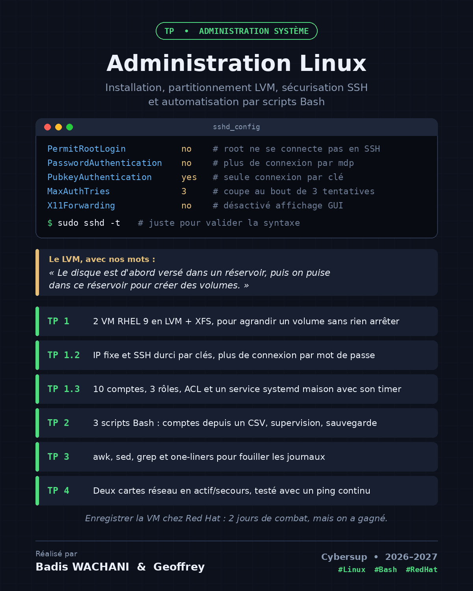

# TP Administration Linux

**Installation, partitionnement LVM, sécurisation SSH et automatisation par scripts Bash**

Cybersup · Bachelor 3 AIS · 2026–2027
Encadré par Sofiane BOULJARF

Fait en binôme par **Badis WACHANI** ([@Badis-Wachani](https://github.com/Badis-Wachani)) et **Geofrey FRAY** ([@gffrey541](https://github.com/gffrey541))



Le scénario : une PME avec plein de serveurs et des tâches encore faites à la main. On a monté deux VM (Red Hat 9 et Ubuntu 24 sous VMware), on les a sécurisées, puis on a automatisé ce qu'on pouvait en Bash.

📄 Le rapport complet avec toutes nos captures : [`rapport/TP_Linux_Badis_Geofrey.pdf`](rapport/TP_Linux_Badis_Geofrey.pdf)

---

## Sommaire

| Dossier | TP | Ce qu'il y a dedans |
|---|---|---|
| [`tp1-installation-ssh/`](tp1-installation-ssh/) | 1.1 et 1.2 | Install RHEL 9 en LVM + XFS, post-install, IP fixe, SSH par clés, config `sshd` |
| [`tp1.3-comptes-acl/`](tp1.3-comptes-acl/) | 1.3 | 10 comptes, 3 groupes (admin, dev, guest), arborescence `/srv` |
| [`tp1.4-service-systemd/`](tp1.4-service-systemd/) | 1.4 | `monapp.sh` + `monapp.service` + `monapp.timer` |
| [`tp1.5-synthese/`](tp1.5-synthese/) | 1.5 | Agrandissement d'un LV et `audit_durcissement.sh` |
| [`tp2-scripts-bash/`](tp2-scripts-bash/) | 2.1 à 2.3 | Nos 3 scripts : comptes depuis un CSV, santé du serveur, sauvegarde |
| [`tp3-awk-sed-grep/`](tp3-awk-sed-grep/) | 3.1 à 3.4 | awk, sed, grep, regex et one-liners sur les journaux |
| [`tp4-bonding/`](tp4-bonding/) | 4.1 | Deux cartes réseau en bond actif/secours |

Dans chaque dossier, il y a un README avec les commandes qu'on a tapées, ce qu'on a compris et nos réponses aux questions du TP.

---

## Les scripts

| Script | Ce qu'il fait | État |
|---|---|---|
| [`mon_script.sh`](tp2-scripts-bash/script1-comptes-csv/mon_script.sh) | Menu pour créer des comptes en lot depuis un CSV, avec vérif et compteur créés / ignorés / rejetés | ✅ fini |
| [`sante.sh`](tp2-scripts-bash/script2-sante/sante.sh) | Menu de supervision : charge, disque, inodes, mémoire, systemd + compteur d'alertes | ✅ fini |
| [`sauvegarde.sh`](tp2-scripts-bash/script3-sauvegarde/sauvegarde.sh) | Menu des options de sauvegarde | 🚧 menu fait, copie et rotation à finir |
| [`audit_durcissement.sh`](tp1.5-synthese/audit_durcissement.sh) | Check-list de sécurité du serveur en 8 parties | ✅ fini |
| [`monapp.sh`](tp1.4-service-systemd/monapp.sh) | Le petit programme lancé par systemd | ✅ fini |

---

## Ce qu'on retient

- Le LVM, avec nos mots : le disque est d'abord versé dans un réservoir, puis on puise dans ce réservoir pour créer des volumes.
- Toujours `sshd -t` avant de recharger SSH. Si on se bloque à distance, il n'y a plus personne pour ouvrir la porte.
- Faire un snapshot avant chaque grosse étape. On en a fait 9 et on s'en est servi.
- Un script qui marche une fois, c'est pas suffisant : il doit pouvoir être relancé sans tout casser (idempotent) et rendre un code de sortie propre.
- L'enregistrement de la VM chez Red Hat nous a pris 2 jours. On a gagné à la fin.

---

## Comment on travaille à deux

- `main` : la version propre du TP
- `badis` : la branche de Badis
- `geofrey` : la branche de Geofrey

Chacun travaille sur sa branche, puis on fait une Pull Request vers `main` que l'autre relit avant de fusionner.

```bash
git checkout geofrey          # ou badis
git pull origin main          # se remettre à jour
# ... on modifie ...
git add .
git commit -m "ce qu'on a changé"
git push origin geofrey
```
